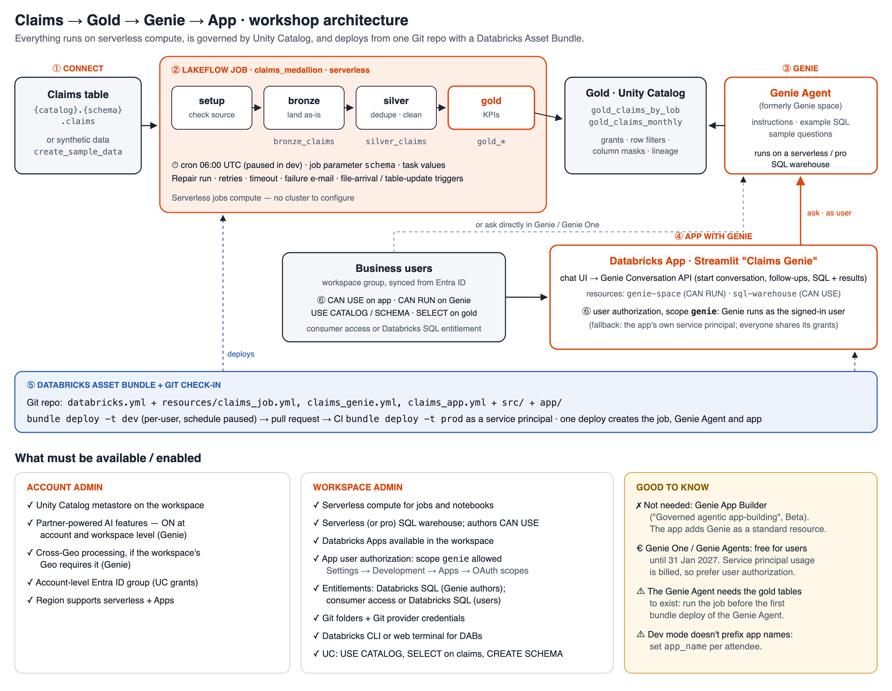

# Claims → Gold → Genie → App — hands-on workshop

A 3.5-hour, hands-on workshop that builds one governed path end to end on Databricks:

**① Connect** to a claims table (or generate synthetic data) → **② Lakeflow Job** builds bronze / silver / gold →
**③ Genie Agent** over the gold tables → **④ Databricks App** (Streamlit) that chats with Genie →
**⑤ Databricks Asset Bundle** + Git check-in → **⑥ authorization and access control**.



## What's here

| Path | What it is |
|---|---|
| `databricks.yml` + `resources/` | The bundle: job `claims_medallion`, Genie Agent `claims_genie`, app `claims_app`; `dev` / `prod` targets |
| `src/00_setup.py` … `03_gold.py` | Job tasks: check the source (or create synthetic claims) → bronze → silver → gold |
| `app/` | Streamlit "Claims Genie" app that uses the Genie Conversation API with **user authorization** (`genie` scope) |
| `notebooks/Workshop_Steps.py` | **Executable guide**: builds and runs the job, creates the Genie Agent, deploys the app, applies grants. Use it for dry runs or as the answer key |
| `WORKSHOP_STEPS.md` | **Step-by-step execution guide**: admin prerequisites, UI steps per module, commands, troubleshooting |
| `docs/architecture.svg` / `.png` | Architecture, plus what must be enabled |

## Agenda (3.5 hours)

| Time | Module |
|---|---|
| 0:00–0:15 | Welcome and architecture |
| 0:15–0:35 | **1 · Connect** to the claims table, or generate synthetic claims |
| 0:35–1:10 | **2 · Lakeflow Job** to gold: dependent tasks, schema as a job parameter, Repair run, schedule and triggers |
| 1:10–1:25 | Break |
| 1:25–2:00 | **3 · Genie Agent** on gold: instructions, example SQL, sample questions, Monitor |
| 2:00–2:35 | **4 · App with Genie**: Streamlit chat with the Genie Agent as an app resource; user authorization |
| 2:35–2:45 | Break |
| 2:45–3:10 | **5 · DAB and check-in**: `bundle generate`, `validate`, `deploy`, `run`; branch, commit, PR; CI to prod |
| 3:10–3:25 | **6 · Authorization and access control**: UC grants, Genie `CAN RUN`, app `CAN USE`, user vs service-principal identity, row-filter demo |
| 3:25–3:30 | Recap |

## What must be enabled

| Who | What |
|---|---|
| Account admin | Unity Catalog metastore · **partner-powered AI features** (required for Genie) · cross-Geo processing if your Geo requires it · Entra ID (SCIM) group for attendees |
| Workspace admin | Serverless jobs and notebooks · serverless (or pro) SQL warehouse · **Databricks Apps** · app OAuth scopes allow **`genie`** (Settings → Development → Apps) · Databricks SQL / consumer entitlements · Git folders |
| Not needed | **Genie App Builder** ("Governed agentic app-building", Beta). The app adds the Genie Agent as a standard app resource |

Genie One and Genie Agents usage is free for users until 31 January 2027. Service-principal usage is billed, so the app uses **user authorization**.

## Quick start (bundle)

```bash
databricks auth login --host https://<workspace-url>

export BUNDLE_VAR_catalog=main
export BUNDLE_VAR_schema=claims                     # schema that holds the claims table
export BUNDLE_VAR_target_schema=claims_<you>        # where bronze / silver / gold are written
export BUNDLE_VAR_warehouse_id=<sql warehouse id>
export BUNDLE_VAR_app_name=claims-genie-<you>       # unique per person; lowercase, max 30 chars
export BUNDLE_VAR_group_name=<workspace group>
# export BUNDLE_VAR_create_sample_data=true         # no claims table yet? generate synthetic claims

databricks bundle validate -t dev
databricks bundle deploy   -t dev     # first time: creates the job; Genie needs gold to exist
databricks bundle run claims_medallion -t dev
databricks bundle deploy   -t dev     # creates the Genie Agent and the app
databricks bundle run claims_app -t dev
```

**Without a terminal:** import the repo as a Git folder, open `notebooks/Workshop_Steps`, set the widgets, and click **Run all**.

**Your own claims table** needs these columns:
`claim_id, policy_id, line_of_business, channel, loss_date, report_date, claim_status, incurred_amount, paid_amount`.
If yours differ, change only the `SELECT` in `src/02_silver.py`.

## Notes

- Use `export BUNDLE_VAR_…`. In zsh, `V="--var=… --var=…"; … $V` is not word-split, so the variables are silently dropped.
- Dev mode prefixes **job** and **Genie Agent** names per user and pauses schedules. It doesn't prefix **app** names.
- Clean up with `databricks bundle destroy -t dev`.

All data in this repo is synthetic.
