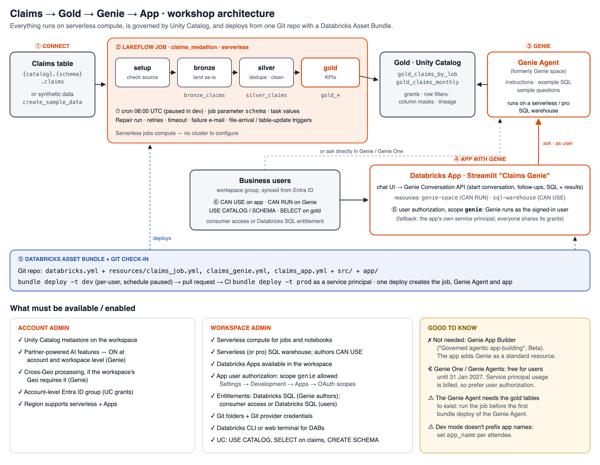

# Claims → Gold → Genie → App: step-by-step

**Duration:** 3.5 hours with 2 breaks · **Compute:** serverless · **Architecture:** [`docs/architecture.png`](docs/architecture.png)

The flow: **① connect to claims** (or generate synthetic data) → **② Lakeflow Job builds gold** → **③ Genie Agent on gold** → **④ Streamlit app with Genie** → **⑤ capture everything in a DAB and check it in** → **⑥ authorization and access control**.



## What's in this repo

| Path | What it is |
|---|---|
| `databricks.yml` | Bundle root: variables and `dev` / `prod` targets. Includes `resources/*.yml` |
| `resources/claims_job.yml` | Lakeflow Job `claims_medallion`: setup → bronze → silver → gold, with a schedule |
| `resources/claims_genie.yml` | Genie Agent (Genie space) over the gold tables: instructions, example SQL, sample questions, `CAN_RUN` for the group |
| `resources/claims_app.yml` | Streamlit app with the Genie Agent and SQL warehouse as resources, the `genie` user-authorization scope, and `CAN_USE` for the group |
| `src/00_setup.py` … `03_gold.py` | Job tasks |
| `app/` | `app.py` (Genie chat), `app.yaml`, `requirements.txt` |
| `notebooks/Workshop_Steps.py` | **Executable guide.** Runs modules 1, 2, 3, 4 and 6 in code. Use it for dry runs or as the answer key |

---

## Step 0 · Before the day (admins, about one week ahead)

These are the prerequisites; the right-hand panels of the architecture diagram show the same list.

**Account admin**
1. Attach the workspace to a Unity Catalog metastore.
2. Turn on **partner-powered AI features** at account and workspace level. Genie needs this.
3. Turn on **cross-Geo processing** if the workspace's Geo requires it for Genie.
4. Sync an Entra ID group for attendees into the **account**, e.g. `workshop-users`, and assign it to the workspace. Unity Catalog grants only accept **account-level** groups; workspace-local groups are rejected.

**Workspace admin**
5. Check that serverless compute for jobs and notebooks is available.
6. Check there's a **serverless (or pro) SQL warehouse**, and give attendees `CAN USE` on it. Genie authors need it.
7. Check that **Databricks Apps** is available in the workspace.
8. Check **Settings → Development → Apps → Restrict OAuth scopes for apps**. It must be **All APIs**, or include **`genie`**.
9. Give the group these entitlements:
   - **Databricks SQL** for attendees, because they create Genie Agents;
   - **consumer access** or Databricks SQL for business users.
10. Unity Catalog grants for the group:
    - `USE CATALOG` on the catalog;
    - `USE SCHEMA` and `SELECT` on the claims schema;
    - `CREATE SCHEMA` on the catalog, or pre-create a gold schema per attendee.
11. Make this repo available in your Git provider. Attendees clone it as a **Git folder** and need Git credentials set under **Settings → Linked accounts**.
12. Decide how attendees will run the Databricks CLI: installed on a laptop, or the workspace **web terminal**.

> **Not needed:** the **Genie App Builder** preview ("Governed agentic app-building", Beta). The app here adds the Genie Agent as a standard app resource.

**Dry run (facilitator):**
- Open `notebooks/Workshop_Steps` and set the widgets: `catalog`, `schema`, `warehouse_id` and `group_name`.
- Click **Run all**. It takes about 15 minutes and ends with an app URL.
- Open the app and ask *"Which line of business has the most open claims?"*
- Set `cleanup = yes` and run the last cell.

---

## 0:00 · Welcome & objectives (5 min)

Introductions and goals. Check that everyone can log in to the workspace and see the Git folder.

## 0:05 · Overview of Databricks (10 min)

The Data Intelligence Platform, and where each module of today fits:

| Platform area | What it does | Today |
|---|---|---|
| **Unity Catalog** | One governance layer for data, AI and apps: grants, row filters, column masks, lineage, audit | Module 6 (and everything else) |
| **Lakeflow** | Connect (ingestion), Declarative Pipelines, **Jobs** (orchestration) | Module 2 |
| **Databricks SQL & AI/BI** | Serverless SQL warehouses, dashboards, **Genie** for natural-language questions | Module 3 |
| **Databricks Apps** | Governed data and AI apps on serverless compute | Module 4 |
| **Asset Bundles & Git folders** | Infrastructure as code and CI/CD for all of the above | Module 5 |
| **Cloud integration** | Identity provider groups (Entra ID), cloud storage, BI tools | Prerequisites, Module 6 |

Finish on the architecture diagram: today's path through the platform. Then open the claims table in **Catalog Explorer**.

## 0:15 · Module 1 — Connect to the claims table or generate synthetic data (20 min)

1. In **Catalog Explorer**, open `<catalog>.<schema>.claims`. Look at the columns, a sample of rows, and the **Permissions** tab.
2. Check that the columns match what the job expects:
   `claim_id, policy_id, line_of_business, channel, loss_date, report_date, claim_status, incurred_amount, paid_amount`.
   If the names differ, change only the `SELECT` in `src/02_silver.py`.
3. **No claims table?** Use `create_sample_data = true` in Module 2. The setup task then creates about 5,000 synthetic claims, with planted duplicates and messy status values for silver to clean.

## 0:35 · Module 2 — Lakeflow Job to create gold (35 min)

1. Go to **Jobs & Pipelines → Create job**, name it `claims-medallion-<you>`, and add four **Notebook** tasks from `src/`, all on **Serverless**:

   | Task | Notebook | Depends on |
   |---|---|---|
   | `setup` | `00_setup` | — |
   | `bronze` | `01_bronze` | `setup` |
   | `silver` | `02_silver` | `bronze` |
   | `gold` | `03_gold` | `silver` |

2. Under **Job parameters**, add these:

   | Parameter | Value |
   |---|---|
   | `catalog` | your catalog |
   | `schema` | the claims schema |
   | `claims_table` | `claims` |
   | `target_schema` | `<schema>_<you>` |
   | `create_sample_data` | `false` or `true` |
   | `run_date` | `{{job.start_time.iso_date}}` |
   | `simulate_failure` | `false` |

3. **Run now.** Watch the graph, then find `bronze_claims`, `silver_claims`, `gold_claims_by_lob` and `gold_claims_monthly` under `target_schema`.
4. **Repair run:**
   - Choose **Run now with different settings** and set `simulate_failure = true`. `silver` fails and `gold` is skipped.
   - Click **Repair run** with `simulate_failure = false`. Only `silver` and `gold` re-run.
5. **Schedule:**
   - **Add trigger → Scheduled**, cron `0 0 6 * * ?`, timezone UTC, then **pause** it.
   - Set max concurrent runs to 1, and add a retry on `gold` and a failure notification.
   - Talk through the **file arrival** and **table update** trigger options.

## 1:10 · Break (15 min)

## 1:25 · Module 3 — Create the Genie Agent (35 min)

1. Go to **Genie → New**, add `gold_claims_by_lob` and `gold_claims_monthly`, then click **Create**.
2. Under **Configure → Settings**:
   - Title: `Claims Gold — Genie (<you>)`;
   - Warehouse: the serverless SQL warehouse;
   - Add a description.
3. Under **Instructions**, paste the text instructions from `resources/claims_genie.yml`. They define *open claims*, *severity* and *outstanding*, and say which table to use for trends and which for totals.
4. Add the two **example SQL queries** and the four **sample questions** from the same file.
5. Test these questions:
   - *Which line of business has the most open claims?* → Motor in the synthetic data;
   - the follow-up *…and its average severity?*;
   - *Show incurred vs paid by line of business*.
6. Open **Monitor** to see the questions and the SQL that Genie generated.
7. Copy the **space ID** from the URL (`/genie/rooms/<space-id>`). You need it in Module 4.

## 2:00 · Module 4 — Create the app with Genie (35 min)

1. Go to **Compute → Apps → Create app → Custom** and name it `claims-genie-<you>`.
2. Under **App resources**, add two:
   - **Genie Agent:** your space, permission **Can run**, resource key `genie-space`;
   - **SQL warehouse:** permission **Can use**, resource key `sql-warehouse`.
3. Under **User authorization**, click **+ Add scope → `genie`**.
4. Click **Create**, then **Deploy** from the Git folder path `…/app`.
5. Open the app and accept the consent prompt. That's user authorization at work.
6. Ask a question, then a follow-up. Expand **SQL generated by Genie**.
7. In the sidebar, check the **Runs as** line: it should say *you (user authorization)*.
8. Walk through `app/app.py`:
   - `start_conversation_and_wait` and `create_message_and_wait`;
   - `get_message_attachment_query_result` for the result table;
   - the `client()` function that picks the user token or the service principal.

## 2:35 · Break (10 min)

## 2:45 · Module 5 — Create the DAB and check it in (25 min)

**1 · Capture what you built in the UI as YAML**

Compare each generated file with `resources/*.yml`, then delete the generated ones.

```bash
databricks bundle generate job         --existing-job-id   <job id>
databricks bundle generate genie-space --existing-id <space id>
databricks bundle generate app         --existing-app-name claims-genie-<you>
```

**2 · Set the variables once per terminal**

This form works in bash and zsh.

```bash
export BUNDLE_VAR_catalog=<catalog>
export BUNDLE_VAR_schema=<claims schema>
export BUNDLE_VAR_target_schema=<claims schema>_<you>_dab
export BUNDLE_VAR_warehouse_id=<warehouse id>
export BUNDLE_VAR_app_name=claims-genie-<you>-dab     # lowercase, max 30 chars
export BUNDLE_VAR_group_name=workshop-users
```

**3 · Deploy and run in dev**

```bash
databricks bundle validate -t dev
databricks bundle deploy   -t dev     # creates the job; the Genie Agent needs gold to exist first (see note)
databricks bundle run claims_medallion -t dev
databricks bundle deploy   -t dev     # now creates the Genie Agent and the app
databricks bundle run claims_app -t dev
```

**4 · Check it in**

```bash
git checkout -b feature/<you>-claims-genie
git add -A && git commit -m "Claims gold job, Genie Agent and Genie app as a bundle"
git push -u origin HEAD                # then open a pull request
```

> **Fresh-workspace note.** A Genie Agent can only be created once its tables exist. So the first `bundle deploy` creates the job and reports errors for the Genie Agent and app. Run the job, then deploy again. After that, one `bundle deploy` handles all three.

What to point out:
- In dev mode, the job and Genie Agent names get a `[dev <you>]` prefix and the schedule is paused. **App names aren't prefixed**, which is why `app_name` is set per person.
- **Promotion:** after the pull request merges, CI (Azure DevOps or GitHub Actions) runs `databricks bundle deploy -t prod` as a **service principal**, with prod variables such as `schema=claims` and `target_schema=claims_gold`.

## 3:10 · Module 6 — Authorization and access control (15 min)

There are three layers, all granted to the same group. In the bundle, the Genie and app grants are the `permissions:` blocks.

| Layer | Grant | Where |
|---|---|---|
| Data | `USE CATALOG`, `USE SCHEMA`, `SELECT` on the gold schema | Catalog Explorer → Permissions, or `GRANT …` |
| Genie Agent | **Can run** | Genie → Share (bundle: `resources/claims_genie.yml`) |
| App | **Can use** | App → Permissions (bundle: `resources/claims_app.yml`) |

```sql
GRANT USE CATALOG ON CATALOG <catalog> TO `workshop-users`;
GRANT USE SCHEMA, SELECT ON SCHEMA <catalog>.<gold schema> TO `workshop-users`;
```

**Whose identity does the app use?**
- **User authorization** (the `genie` scope, which this app uses): Genie runs as the signed-in user. Their own Unity Catalog grants, row filters and column masks apply, and each question is logged under their name.
- **App authorization** (no scope): everyone shares the app's **service principal**. You then grant that service principal `CAN RUN` and `SELECT`, and everyone sees the same data.
- Genie usage is free for users until 31 January 2027, but service-principal usage is billed. That's another reason to prefer user authorization.

**Demo: the same app shows different data per user.** Add a row filter on the gold table:

```sql
CREATE FUNCTION <catalog>.<gold schema>.lob_filter(lob STRING) RETURN
  NOT is_account_group_member('workshop-users') OR lob IN ('Motor', 'Property');
ALTER TABLE <catalog>.<gold schema>.gold_claims_by_lob SET ROW FILTER <catalog>.<gold schema>.lob_filter ON (line_of_business);
```

Ask the app the same question again. Group members now see only Motor and Property, and nothing in the app changed. Remove the filter with `ALTER TABLE … DROP ROW FILTER`.

## 3:25 · Recap (5 min)

The path you followed: UI → bundle → pull request → CI to prod. Governance applies in one place, Unity Catalog, and Genie and the app both respect it.

**Clean up:** run `databricks bundle destroy -t dev`, then run the notebook's last cell with `cleanup = yes`.

---

## Troubleshooting

| Symptom | Fix |
|---|---|
| `bundle validate`: *no value assigned to required variable* | Export `BUNDLE_VAR_schema`, `BUNDLE_VAR_target_schema` and `BUNDLE_VAR_warehouse_id` in this terminal. In zsh, `V="--var=… --var=…"; … $V` silently passes nothing. |
| `bundle deploy`: *Failed to fetch tables for the agent* | The gold tables don't exist yet. Run `bundle run claims_medallion`, then deploy again. |
| `bundle deploy` fails because the app name exists | Set a unique `BUNDLE_VAR_app_name`. |
| The Genie sidebar icon is there but Genie won't open | Partner-powered AI features are off (account admin). |
| The app says *PermissionDenied* or returns an empty answer | Check `CAN RUN` on the Genie Agent and `SELECT` on gold for the user. Without user authorization, check those for the app's service principal instead. |
| The app's sidebar says *Runs as: the app's service principal* | The `genie` scope is missing, or an admin restricted OAuth scopes. Add it under **App → Edit → User authorization**, then redeploy. |
| `GRANT … TO workshop-users` fails with *PRINCIPAL_DOES_NOT_EXIST* | The group is workspace-local. Use an account-level group synced from Entra ID. |
| `setup` fails: *Claims table … not found* | Check the `catalog`, `schema` and `claims_table` parameters, or use `create_sample_data=true`. |
| `silver` fails: *cannot resolve column* | Map your column names in the `SELECT` in `src/02_silver.py`. |
